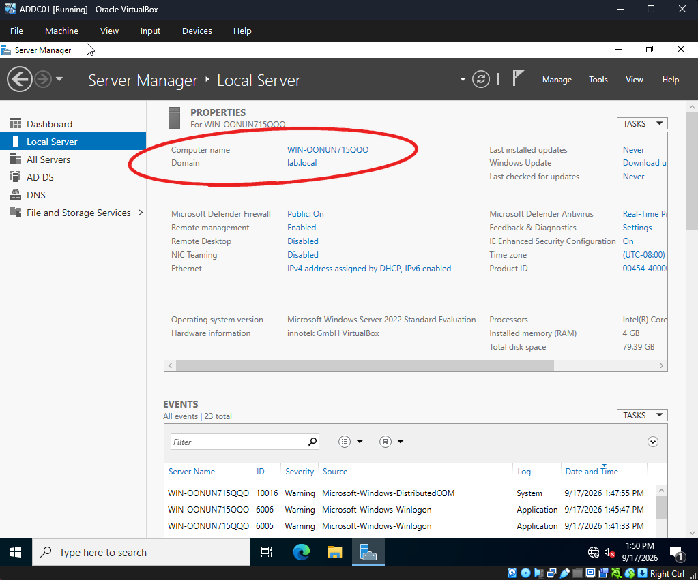
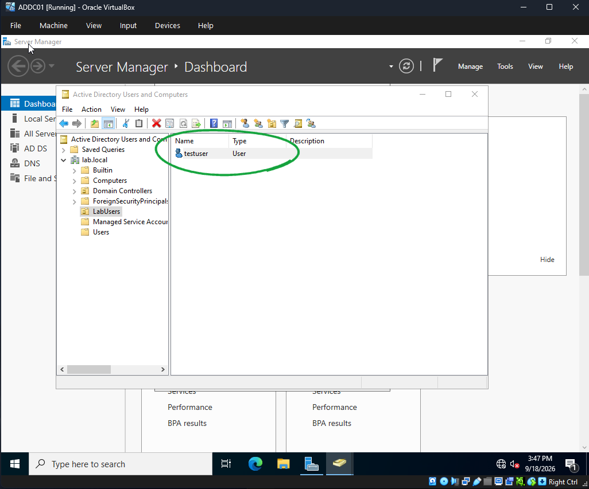
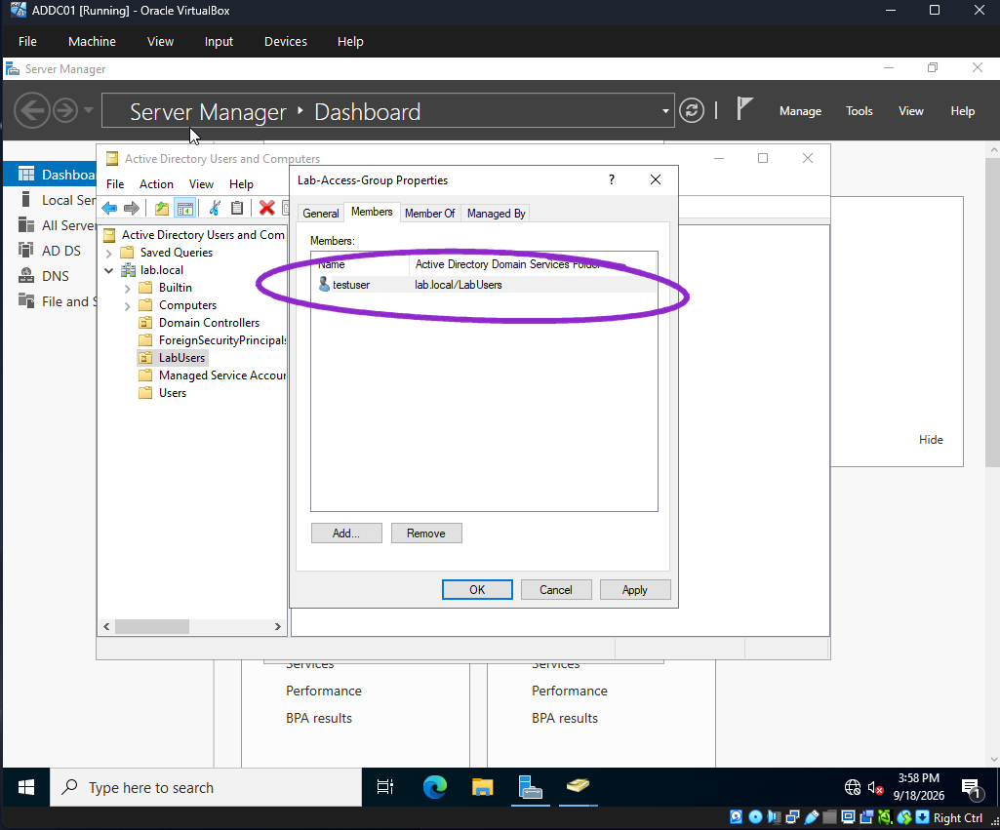
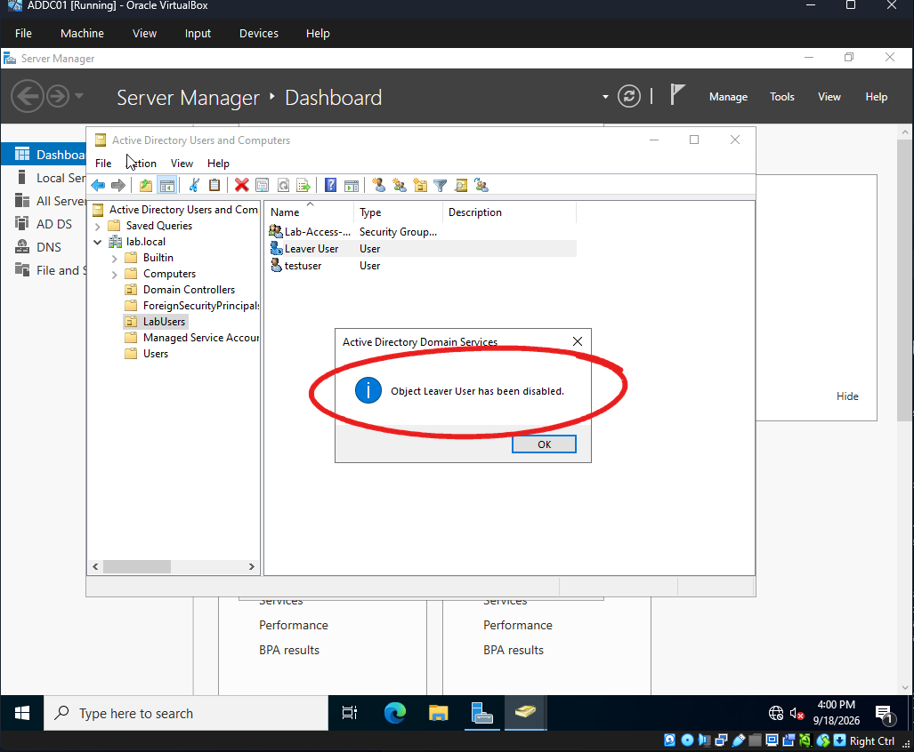
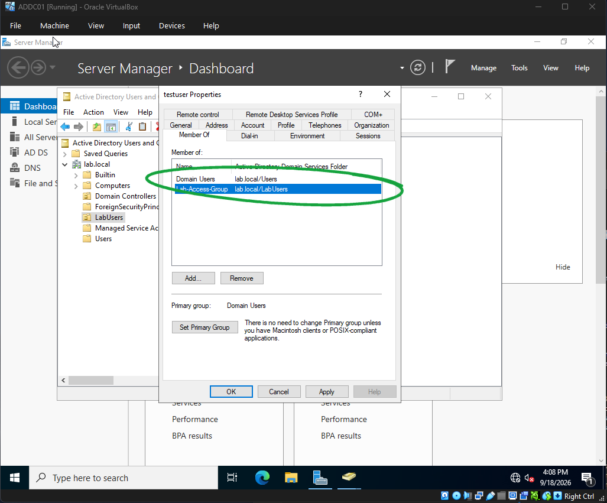
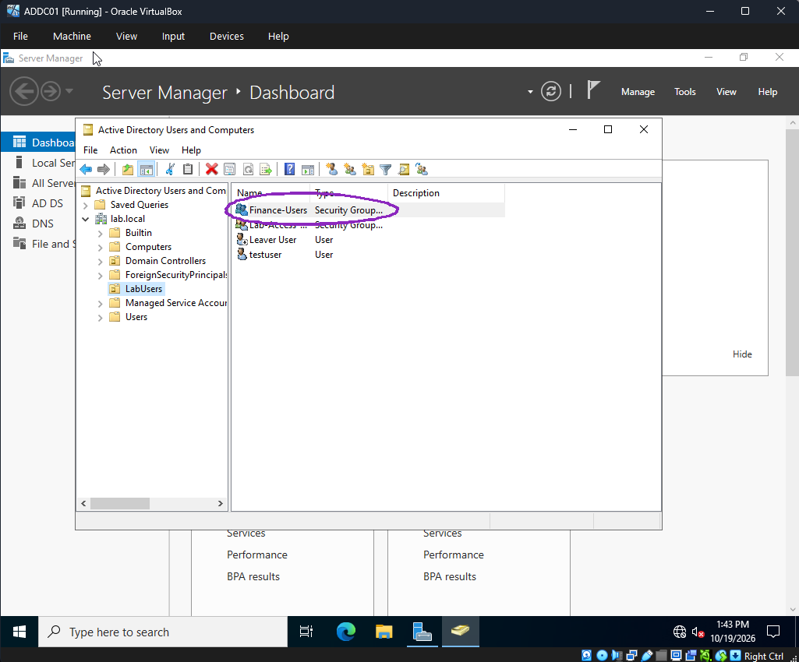
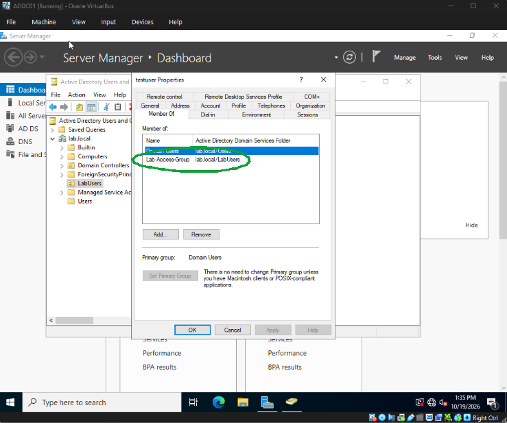
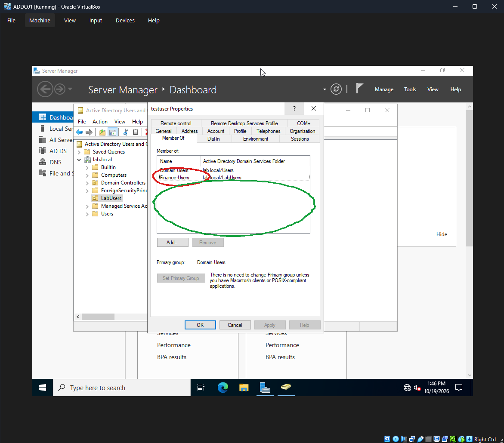

# AD User Lifecycle Lab

Hands-on lab, Sep-Oct 2026.

Ticket-style Active Directory user lifecycle on a real Windows Server 2022 domain controller: create users, reset password (lab notes), assign group access, move a user to a new role, disable a leaver, document membership: the full joiner / mover / leaver lifecycle.

Screenshots only prove what is listed. Entra and Okta live in other repos.

## Scope

| # | Item | Dump |
| --- | --- | --- |
| 1 | VirtualBox VM **ADDC01**, Windows Server 2022 Desktop Experience | Done (17 Sep 2026) |
| 2 | Promote DC: domain **lab.local** (NetBIOS **LAB**), AD DS + DNS | Done (17 Sep 2026) |
| 3 | OU **LabUsers**; users **testuser** / Test User, **Leaver User** / leaver | Done (18 Sep 2026) |
| 4 | Security group **Lab-Access-Group**; add **testuser**; Member Of proof | Done (18 Sep 2026) |
| 5 | Disable **Leaver User** | Done (18 Sep 2026) |
| 6 | Password reset on Test User | Lab notes only — no clean dialog shot without a visible password field |
| 7 | Mover: testuser moved to finance role, granted **Finance-Users**, removed **Lab-Access-Group** | Done (19 Oct 2026) |

## Environment

| Object | Value |
| --- | --- |
| Hypervisor | Oracle VirtualBox |
| VM | **ADDC01** |
| OS | Windows Server 2022 Standard Evaluation, Desktop Experience |
| Domain | **lab.local** (NetBIOS **LAB**) |
| Roles | AD DS, DNS |
| OU | **LabUsers** |
| Users | **testuser** (active); **Leaver User** (disabled after offboard) |
| Group | **Lab-Access-Group** — Global, Security, in LabUsers; member **testuser** |
| Access proof | testuser **Member Of** → Lab-Access-Group (Sep 18) |
| Mover group | **Finance-Users** — Global, Security, in LabUsers (19 Oct 2026) |
| Access after move | testuser **Member Of** → Domain Users + Finance-Users only |

## Screenshots

### Screenshots (17 Sep 2026 foundation)

- [VirtualBox: ADDC01 created](screenshots/01-vbox-addc01-created.png)
- [Windows Server 2022 ISO download](screenshots/02-windows-server-2022-iso-download.png)
- [Promote review: lab.local / LAB](screenshots/03-review-options-lab-local.png)
- [Prerequisites check passed](screenshots/04-prerequisites-check-passed.png)
- [Local Server: Domain lab.local, AD DS + DNS](screenshots/05-local-server-domain-lab-local.png)

  

- [ADUC open on lab.local](screenshots/06-aduc-lab-local.png)
- [ADUC default containers](screenshots/07-aduc-containers.png)

### Screenshots (18 Sep 2026 lifecycle)

- [Server Manager: AD DS + DNS healthy](screenshots/08-server-manager-ad-ds-dns.png)
- [OU LabUsers created](screenshots/09-ou-labusers.png)
- [testuser in LabUsers](screenshots/10-testuser-in-labusers.png)

  

- [LabUsers: Leaver User + testuser](screenshots/11-labusers-both-users.png)
- [Lab-Access-Group General: Global Security](screenshots/12-lab-access-group-general.png)
- [Lab-Access-Group Members: testuser](screenshots/13-group-members-testuser.png)

  

- [Leaver User disabled confirmation](screenshots/14-leaver-disabled.png)

  

- [testuser Member Of: Lab-Access-Group](screenshots/15-testuser-member-of-lab-access-group.png)

  

### Screenshots (19 Oct 2026 mover)

- [testuser Member Of before move: Domain Users + Lab-Access-Group](screenshots/19-testuser-member-of-before-move.png) (cropped to the VirtualBox window)
- [Finance-Users created in LabUsers](screenshots/16-finance-users-created.png) (cropped to the VirtualBox window)

  

- [Select Groups: adding Finance-Users to testuser](screenshots/17-select-groups-finance-users.png)
- [testuser Member Of after move: Domain Users + Finance-Users](screenshots/18-testuser-member-of-after-move.png)

## What was built

### Foundation (short)

1. Created VirtualBox VM **ADDC01** (4 GB RAM, 80 GB disk).
2. Installed Windows Server 2022 Desktop Experience from the evaluation ISO.
3. Installed AD DS + DNS and promoted the server as the first DC in a new forest: domain **lab.local**, NetBIOS **LAB**, forest/domain functional level Windows Server 2016, Global Catalog + DNS.
4. Confirmed Local Server shows Domain **lab.local** and ADUC opens against the domain.

### User lifecycle

1. Created OU **LabUsers** under **lab.local**.
2. Created user **testuser** (display name Test User) in LabUsers.
3. Created user **Leaver User** in LabUsers.
4. Created security group **Lab-Access-Group** (Global, Security) in LabUsers.
5. Added **testuser** as a member of Lab-Access-Group (Members tab).
6. Practiced a password reset on Test User in the lab (no screenshot shipped — see gaps).
7. Disabled **Leaver User**; AD DS confirmation: “Object Leaver User has been disabled.”
8. Documented access from the user side: **testuser** → Member Of → **Lab-Access-Group**.

## Mover (19 Oct 2026)

Ticket-style, done ~1:35–1:46 PM PT on **ADDC01** (lab.local, VirtualBox). Goal: least privilege. When someone changes role they get the new role's access and lose the old one, so access doesn't pile up (privilege creep).

1. **Request:** testuser is changing to a finance role.
2. **Created** security group **Finance-Users** (Global, Security) in OU **LabUsers**.
3. **Added** testuser to Finance-Users (testuser → Member Of → Add → Select Groups).
4. **Removed** the old role access: **Lab-Access-Group**.
5. **Verified** Member Of: **Domain Users** + **Finance-Users** (lab.local/LabUsers) only. Lab-Access-Group is gone.

In my own words: "testuser is a person in the company that's moving to a finance role. I changed his job permissions to finance and removed his old role access to Lab-Access-Group. He doesn't need those since he's not in that role anymore, so he only has access to what he's supposed to."

**Before (19 Oct 2026, ~1:35 PM PT):** testuser Member Of = Domain Users + Lab-Access-Group (old role access).

**After (19 Oct 2026):** Finance-Users added; the empty space where Lab-Access-Group used to be shows it was removed.

## How to redo it

On the host: Oracle VirtualBox. Guest: Windows Server 2022 evaluation ISO (Desktop Experience).

Foundation:

1. Create VM **ADDC01**. Attach the Server 2022 ISO. Install Desktop Experience. Set a local admin password you will not paste into screenshots or this repo.
2. Server Manager → **Add roles and features** → **Active Directory Domain Services** (+ DNS when prompted). Promote this server to a domain controller.
3. Deployment: **Add a new forest**. Root domain name: `lab.local`. NetBIOS: `LAB`. Keep Global Catalog and DNS. Complete Prerequisites Check → Install. Reboot.
4. After reboot, Local Server should show Domain **lab.local**. Open **Active Directory Users and Computers** and confirm the domain tree.

Lifecycle:

5. In ADUC, right-click **lab.local** → **New** → **Organizational Unit** → name `LabUsers`.
6. Right-click LabUsers → **New** → **User**. First/last or full name **Test User**, logon name **testuser**. Set password; leave account enabled. Finish.
7. Repeat for **Leaver User** / logon **leaver**. Leave enabled until the offboard step.
8. Right-click LabUsers → **New** → **Group**. Name `Lab-Access-Group`. Scope **Global**, type **Security**. Create.
9. Open Lab-Access-Group → **Members** → **Add** → select **testuser** → OK. Confirm Members lists testuser under `lab.local/LabUsers`.
10. (Optional / practiced) Right-click Test User → **Reset Password**. Do not capture a dialog that shows the typed password. Clear “User must change password at next logon” only if your lab policy allows.
11. Right-click **Leaver User** → **Disable Account**. Confirm the AD DS message that the object was disabled. Icon shows the disabled overlay.
12. Open **testuser** → **Member Of**. Expect **Domain Users** and **Lab-Access-Group**. That is the access-change proof for the ticket.

Mover:

13. Right-click LabUsers → **New** → **Group**. Name `Finance-Users`. Scope **Global**, type **Security**.
14. Open **testuser** → **Member Of** → **Add** → type `Finance-Users` → Check Names → OK.
15. Still on Member Of, select **Lab-Access-Group** → **Remove** → Yes → Apply.
16. Confirm Member Of lists only **Domain Users** and **Finance-Users**.

Docs: [Install AD DS](https://learn.microsoft.com/en-us/windows-server/identity/ad-ds/deploy/install-active-directory-domain-services--level-100-), [ADUC](https://learn.microsoft.com/en-us/windows-server/identity/ad-ds/get-started/virtual-dc/active-directory-domain-services-overview).

## What broke / gaps

- **No clean password-reset dialog shot.** Reset was practiced on Test User in the lab. Any capture that would show a typed password was not shipped. Treat reset as lab notes, not screenshot-proven.
- **Wrong-tab / empty Add dialogs** during Member Of work (Domain Users Members confusion, empty Add pickers) were skipped. Final proof is Lab-Access-Group Members + testuser Member Of.
- **Computer name** stayed the auto-generated `WIN-OONUN715QQO` in early promote/Local Server shots; later ADUC shows `ADDC01.lab.local`. VM name in VirtualBox is **ADDC01** throughout.
- **Static IP warning** on Prerequisites Check (DHCP on the NIC). Lab continued; DNS still came up. Production DCs should use a static address.
- Isolated lab NIC (red network “x” on some shots) is expected for a host-only / offline lab.

## Demo walkthrough

Walk this in ADUC on **ADDC01**, not a slide deck.

1. **Foundation:** Local Server Domain **lab.local**; left nav shows AD DS + DNS. ADUC opens on lab.local.
2. **OU LabUsers:** empty, then users appear.
3. **Users:** **testuser** active; **Leaver User** disabled (confirmation dialog + disabled icon).
4. **Group:** **Lab-Access-Group** General = Global Security; Members = **testuser**.
5. **Access:** open **testuser** → Member Of → **Lab-Access-Group** (Sep 18 state).
6. **Mover:** show **Finance-Users** in LabUsers, then testuser → Member Of → **Domain Users + Finance-Users** only; Lab-Access-Group removed.

Stop there. Entra IAM and Okta are other repos.

## Dated progress

| When | What the dump shows |
| --- | --- |
| 2026-09-17 | VirtualBox ADDC01; Server 2022 ISO; promote review lab.local / LAB; prereqs passed; Local Server Domain lab.local; ADUC open |
| 2026-09-18 ~3:36–3:40 PM PT | Server Manager healthy; OU LabUsers created |
| 2026-09-18 ~3:47–3:54 PM PT | testuser then Leaver User in LabUsers |
| 2026-09-18 ~3:55–3:58 PM PT | Lab-Access-Group created (Global Security); testuser added as member |
| 2026-09-18 ~4:00 PM PT | Leaver User disabled |
| 2026-09-18 ~4:08 PM PT | testuser Member Of Lab-Access-Group (final access proof) |
| 2026-10-19 ~1:35–1:46 PM PT | Mover: before Member Of (Domain Users + Lab-Access-Group); Finance-Users created; testuser added; Lab-Access-Group removed; Member Of = Domain Users + Finance-Users |

## Stop there

Entra, Okta, CyberKy/LLDAP, and CyberArk are other sittings / other repos. This package covers AD user lifecycle only.
